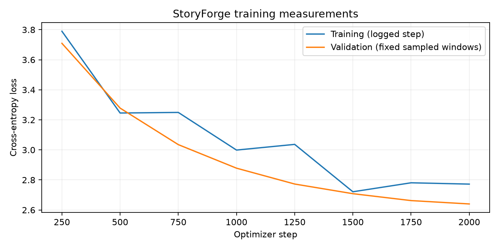

# StoryForge — a small language-model lab

Train a compact story-completion model from random weights, inspect its learning curves,
and compare cached decoding with ordinary decoding. This is an educational language
model, not a general-purpose chatbot.

The default configuration uses three decoder blocks, three attention heads, a
192-dimensional hidden representation, a 512-token byte-level BPE vocabulary and
256-token context. Token embeddings and the output layer share weights. RoPE replaces
learned position embeddings; an optional learned-position configuration supports a baseline.
KV caching reuses attention keys and values during generation without adding parameters.

**Included:** actual TinyStories weights trained for 2,000 CPU steps; 1,433,280 parameters.
Best measured validation loss: **2.6402**. This is a limited-budget early
checkpoint, with quality limitations documented in `MODEL_CARD.md`. Seven automated tests
passed. All reported results belong to this run.



## Install

Use Python 3.10–3.12. From this folder:

```bash
python -m venv .venv
# Linux/macOS:
source .venv/bin/activate
# Windows PowerShell instead:
# .venv\Scripts\Activate.ps1
python -m pip install --upgrade pip
python -m pip install -r requirements.txt
python -m pytest -q
```

For an NVIDIA GPU, install the appropriate PyTorch CUDA build from
https://pytorch.org/get-started/locally/ before the other dependencies.
For Colab, enable a GPU runtime and use `colab_train.ipynb`.
Internet is needed for initial dependencies and the TinyStories dataset.

## Try the included model

The limited TinyStories checkpoint is at `checkpoints/tiny/best.pt`.
Its run uses 10,000 training stories, 1,000 validation stories, 2,000 optimizer steps,
batch size 4 and no gradient accumulation (2,048,000 training-token positions).
This is a much smaller training budget than a run with effective batch 64.
It is an early checkpoint, not a claim of fluent story generation:


```bash
python generate.py --checkpoint checkpoints/tiny/best.pt --prompt "Once upon a time"
```

Read `MODEL_CARD.md` for its actual training budget. New training runs use a separate
`checkpoints/my_run` folder, leaving the supplied checkpoint intact.

## Train on TinyStories

```bash
python prepare_data.py --train-stories 100000 --val-stories 5000
python train.py --steps 5000 --batch-size 16 --accumulation 4
```

The first command trains the tokenizer on training stories only. It removes exact duplicate
stories within splits and excludes exact train/validation overlap. It does not claim to
remove near-duplicates. The second command trains all model parameters from scratch.
The effective batch is 64 sequences with these arguments. Reduce `--batch-size` if GPU
memory is insufficient. Runtime and output quality depend on hardware and training budget;
5,000 steps is a starting experiment, not a quality guarantee. CPU execution is supported
but full training is slow. CUDA is selected automatically when available.

Data is packed into a token stream separated by end-of-text tokens, with random training
windows. Attention can cross story boundaries inside a window. Validation uses fixed sampled
windows for comparable loss estimates, rather than evaluation of every validation token.

Output files:

| Path | Contents |
| --- | --- |
| `checkpoints/my_run/best.pt` | Best validation checkpoint with weights, config, tokenizer and provenance |
| `checkpoints/my_run/last.pt` | Latest checkpoint plus optimizer and RNG state |
| `checkpoints/my_run/metrics.csv` | Training loss, validation loss, perplexity and elapsed time |
| `checkpoints/my_run/run.json` | Actual arguments, device and runtime |

Checkpoint writes are atomic. Resume an interrupted run using the same arguments and total
step target, adding `--resume checkpoints/my_run/last.pt`. Increasing the total step target
changes the cosine learning-rate schedule; it is a continuation experiment, not an exact
reproduction of an uninterrupted run. CPU RNG and CUDA RNG are stored; deterministic GPU
kernels are not forced. Use a new output directory for a fresh experiment.

## Generate and serve

```bash
python generate.py --checkpoint checkpoints/my_run/best.pt --prompt "A little fox found a key"
python benchmark.py --checkpoint checkpoints/my_run/best.pt
python plot_training.py --csv checkpoints/my_run/metrics.csv
python -m uvicorn serve:app --host 127.0.0.1 --port 8000
```

Open http://127.0.0.1:8000/docs for an interactive API. By default the server loads the bundled `checkpoints/tiny/best.pt`. Set `STORYGPT_CHECKPOINT` to
select another model and `STORYGPT_DEVICE=cuda` for GPU serving. The service serializes
requests for predictable single-model use; it is a local demo, not a production deployment.
Generation supports temperature, top-k, top-p and `--no-cache`. It stops at end-of-text
or the requested token limit. When context is full, it rebuilds the most recent window
so cached and uncached decoding follow the same positional convention.

## Reproduce the offline integration run

```bash
python make_demo.py
python train.py --data data/demo --config configs/demo.json --out checkpoints/demo_run --steps 100 --batch-size 4 --accumulation 1 --eval-every 25 --eval-batches 4 --label synthetic-integration-demo
python generate.py --checkpoint checkpoints/demo_run/best.pt --prompt "Mia found"
```

This creates a tiny synthetic corpus without downloading a dataset. The model keeps the
same width and depth but uses a 64-token context for the test run. It exercises data,
training, serialization and generation; it does not produce a useful general language model.
To repeat data preparation choose a fresh data directory or remove only the previous demo
artifacts. The data preparation command refuses to overwrite an existing prepared dataset.

## Reproduce the bundled TinyStories experiment

Use a fresh data folder and output folder:

```bash
python prepare_data.py --out data/reproduce --train-stories 10000 --val-stories 1000
python train.py --data data/reproduce --out checkpoints/reproduce --steps 2000 --batch-size 4 --accumulation 1 --eval-every 250 --eval-batches 20 --label tinystories-10k-cpu-2000steps --device cpu
```

The reference run used seed 42. `TESTED_ENVIRONMENT.json` records package versions.
Hardware and library differences can change timings and exact numeric results.

## Continue from the supplied checkpoint

The ZIP also includes `checkpoints/tiny/last.pt` for optimizer-state continuation.
Reuse its tokenizer instead of training a different one:

```bash
python prepare_data.py --out data/continue --train-stories 10000 --val-stories 1000 --tokenizer checkpoints/tiny/tokenizer.json
python train.py --data data/continue --out checkpoints/continued --resume checkpoints/tiny/last.pt --steps 5000 --batch-size 4 --accumulation 1 --label tinystories-continuation
```

Changing the total step target changes the schedule. This command is a continuation,
not an exact repeat of a hypothetical uninterrupted 5,000-step run. Keep `last.pt` out
of ordinary Git history; it is intentionally ignored. The inference checkpoint needs
only `best.pt`, which already embeds its tokenizer.

## Compare against learned positions

Copy `configs/tiny.json` to `configs/baseline.json` and set `"position": "learned"`.
Train both configurations using the same prepared data, seed, effective batch and token
budget, with different `--out` folders. Compare validation loss and repeated generation
benchmarks. This isolates the positional method while keeping width and depth fixed.
The RoPE version has 49,152 fewer parameters at context 256 and width 192. Do not claim
RoPE improves quality until the experiment supports it. Sampling controls and BPE are
standard features, not novel contributions.

## Repository map

| File / folder | Responsibility |
| --- | --- |
| `model.py` | Transformer, positional encoding, KV cache and sampling |
| `prepare_data.py` | TinyStories/local text, BPE and token arrays |
| `train.py` | Optimizer, schedule, evaluation, save/resume |
| `generate.py` | Load portable weights and complete a prompt |
| `serve.py` | Local FastAPI service |
| `benchmark.py` | Cached vs uncached greedy generation |
| `plot_training.py` | Plot measured losses from metrics.csv |
| `make_demo.py` | Reproducible offline synthetic fixture |
| `configs/` | Default and integration-run settings |
| `tests/` | Causality, cache parity, gradients and parameter checks |
| `checkpoints/` | Weights and checkpoint guidance |
| `colab_train.ipynb` | GPU training and checkpoint-download workflow |
| `MODEL_CARD.md` | Actual checkpoint status and limitations |
| `ATTRIBUTION.md` | Inspiration, references and implementation provenance |

## Publish your run

Create an empty GitHub repository, then run from this folder:

```bash
git init
git add .
git commit -m "Add StoryForge training and inference project"
git branch -M main
git remote add origin https://github.com/YOUR_USERNAME/YOUR_REPO.git
git push -u origin main
```

After full training, add the selected model explicitly (training artifacts are ignored by
default): `git add -f checkpoints/my_run/best.pt checkpoints/my_run/metrics.csv checkpoints/my_run/run.json`.
The bundled `checkpoints/tiny/best.pt` is already allowed by `.gitignore`.
The small inference checkpoint is suitable for normal Git; avoid repeatedly committing
large optimizer checkpoints. Use Releases or a model host when weights grow. Update the
model card with the real dataset, step count, validation loss and hardware before describing
it as a trained story model. The checkpoint embeds its matching tokenizer, so consumers
do not need your tokenized dataset to run inference.

## Acknowledgments

Inspired by [turancannb02/minigpt](https://github.com/turancannb02/minigpt).
This implementation and README were newly written with AI assistance. Retain attribution
and describe your own experiments honestly. See `ATTRIBUTION.md` for dataset and architecture
references. No original repository checkpoint is bundled.
